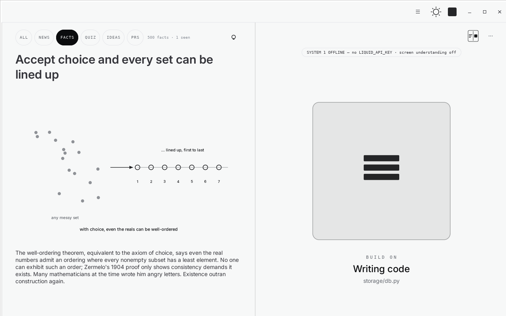
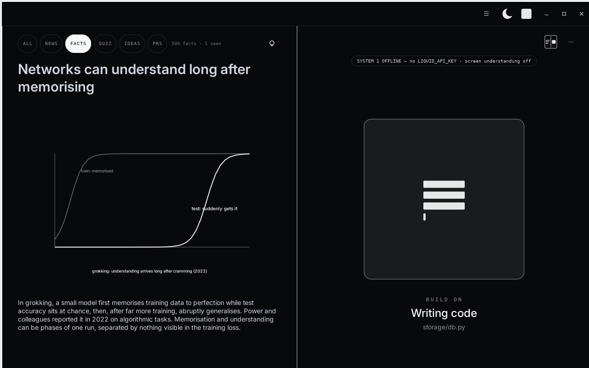

# Fancy Terminal

**A terminal that keeps your project close while your coding agent works.**

Fancy Terminal (Agent-Aware Terminal in the code) is a native Linux terminal
built for the Meta hackathon. It pairs your coding agent with a compact activity
indicator and an optional feed of content about your repository: facts, quizzes,
ideas, news, and open pull requests.

[Watch the 3-minute demo](https://youtu.be/8p3r9JF1y6k) ·
[Setup and usage](agent-aware-terminal/README.md) ·
[Architecture](ARCHITECTURE.md)



*Captured from the built application using its content-tour mode. The activity
indicator is a simulated working state; this is a UI preview, not a live agent run.*

## Why

While an agent reads files, edits code, or runs tests, the developer has a gap
in their workflow. Watching terminal output can be tedious; switching to an
unrelated feed can make it harder to pick up the task again.

Fancy Terminal explores a simple idea: make that waiting time connected to the
project. Open a short card, explore a relevant idea, or catch up on a pull
request, with the agent's activity still visible beside it. The prototype's
benefit to attention and task resumption has not yet been measured in a user study.

## What it does

- **A real terminal.** GTK 3 + VTE, with your existing shell and coding-agent CLI.
  No browser UI, WebKit, or local web server.
- **An agent activity indicator.** One animated square represents thinking,
  searching, editing, testing, completion, or a request for your input.
- **An optional context feed.** Press `Alt+I` to browse project-related content.
  The busy-state hint does not take keyboard focus or open the feed automatically.
  Press `Esc` or click the agent square to return.
- **Project-aware content creation.** A separate researcher studies the repository
  and the current task, then creates cards in `<project>/.aat/content/`.
- **Live pull requests.** The PRs category reads open PRs through the GitHub CLI,
  including changed files, discussion excerpts, and links to the original PRs.
- **Measured changes and labelled judgments.** File counts come from filesystem
  snapshots. DONE and SAFE scores are model judgments with confidence, not proof
  of correctness or a security audit.



*Dark-theme preview, also captured in content-tour mode with a simulated activity state.*

## Models and their roles

Meta's models are the brains behind project-specific content creation. Wonder
was used for development and content creation, and Meta Image for visual
experiments. The researcher integration currently invokes the `muse` CLI by
default; other creator providers can be configured in Settings.

Liquid AI's **System-1 (d1.1)** provides fast, bounded judgments: interpreting
terminal screenshots and text, choosing relevant content, and scoring completed
turns. A local vector index retrieves content candidates before selection.
Without a Liquid key, the app falls back to process/log-based observation and
retrieval ranking; model-based scores stay off.

The repository also retains Meta text/image experiments. Generated project worlds
and posters are **not displayed in the current interface**.

A future research direction is to explore a CLM approach using Glimmer's encoder
as the basis for a System-1-style decision layer. This is an experiment we want
to pursue, not a feature of the current prototype.

## Quick start

On Ubuntu / Debian, install the system bindings and clone the content submodule:

```bash
sudo apt install git python3-gi python3-gi-cairo python3-requests \
    gir1.2-gtk-3.0 gir1.2-vte-2.91
git clone --recurse-submodules https://github.com/FastAnt/meta_hack.git
cd meta_hack/agent-aware-terminal
./run.sh --project ~/dev/my-project
```

Already cloned? Run `git submodule update --init --recursive` from the repository
root. The content catalogue is a separate repository under `games-base/`.

The terminal and catalogue work without API keys. For model features, create a
local `agent-aware-terminal/keys.sh` using your own credentials:

```bash
export MODEL_API_KEY="YOUR_META_API_KEY"
export SYSTEM_1_MODEL_API_KEY="YOUR_LIQUID_API_KEY"
```

This file is git-ignored; never commit it. The app loads it automatically, and
existing environment variables take precedence. Creator CLIs must be installed
and authenticated separately. For PR cards, install `gh` and run `gh auth login`.

To build the application locally:

```bash
./build-binary.sh
./dist/agent-aware-terminal/agent-aware-terminal --project ~/dev/my-project
```

The build bundles Python dependencies; it still needs a compatible Linux desktop
and GTK/VTE libraries. See the [application guide](agent-aware-terminal/README.md)
for configuration, keyboard shortcuts, and troubleshooting.

## Try the loop

1. Open a project and start your coding agent inside the terminal.
2. When the agent starts working, press `Alt+I` to open the feed.
3. Browse **All / News / Facts / Quiz / Ideas / PRs** with the filter chips.
4. Use the bulb button to create one card or keep a small pool of unread cards.
5. When the agent needs input, return to the terminal. At completion, inspect
   measured file changes and any available model scores.

The view button cycles between terminal + visualization, feed + visualization,
and terminal + feed. The theme button cycles Auto, Light, and Dark.

## Development

Create the virtual environment inside `agent-aware-terminal/`. System site
packages are needed for the OS-provided GTK bindings:

```bash
cd agent-aware-terminal
/usr/bin/python3 -m venv --system-site-packages .venv
.venv/bin/pip install requests pycairo
.venv/bin/python -m unittest discover -s backend/tests
python3 tools/simulate.py sims/demo_run.jsonl
```

Run the unit suite without production API credentials in its environment;
some legacy scenarios assume an unconfigured model client.

| Path | Purpose |
| --- | --- |
| [desktop/native_terminal.py](agent-aware-terminal/desktop/native_terminal.py) | GTK/VTE interface and orchestration |
| [backend/app/](agent-aware-terminal/backend/app/) | Observation, perception, content, retrieval, and PR services |
| [backend/tests/](agent-aware-terminal/backend/tests/) | Unit and scenario tests |
| [games-base/](agent-aware-terminal/games-base/) | External content catalogue, tracked as a submodule |
| [content-researcher/](agent-aware-terminal/content-researcher/) | Researcher instructions, lifecycle, and templates |
| [ARCHITECTURE.md](ARCHITECTURE.md) | Data flows, invariants, and implementation details |
| [AGENTS.md](AGENTS.md) | Contributor and coding-agent instructions |

## Prototype limits

Linux is the current target. Screen-based state recognition can be wrong, and
model scores require human review. Generated cards also need review for accuracy.
The default Muse creator uses `--yolo`; its `.aat/` write scope is an instruction,
not an OS sandbox. Use generation only in projects you trust and review its output.
