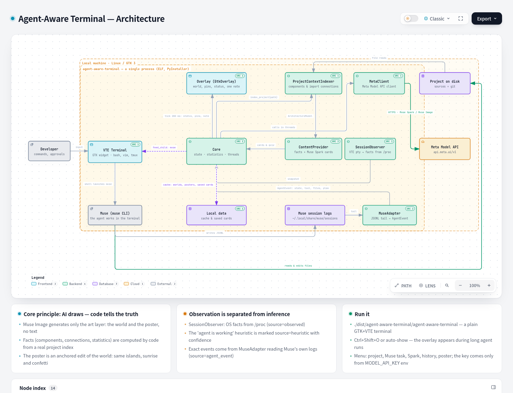

# meta_hack — Agent-Aware Terminal

A hackathon project built for the Meta Muse hackathon: a Linux terminal
that **understands when an AI coding agent is working inside it** and turns
the waiting time into an interactive, living map of your project.

## The idea

When a coding agent (here: **Muse**) works autonomously for minutes —
reading files, editing code, running tests — a regular terminal degrades
into an opaque `Working...`. The user loses the thread, alt-tabs away, and
then pays a context-rebuild cost when the agent finishes or needs them.

**Agent-Aware Terminal keeps the user in the loop without stealing the
terminal.** It is a plain, full-power terminal (GTK + VTE — bash, vim,
tmux, ssh all work as usual) with a calm visual layer on top of it:

- the overlay **opens by itself** when the agent has been working for a
  while, and closes back to the console in one keystroke;
- it shows **what the agent is doing right now in one human sentence**
  ("Editing storage", "Running tests", "The agent needs you");
- behind that status floats a **pixel-art world of your project,
  generated by Muse Image**, with the component the agent is touching
  lit up;
- instead of a dashboard, there is **one contextual insight at a time** —
  a fact about the current component, a project overview, or a quick quiz
  about the architecture, written by **Muse Spark**;
- when a session completes, Muse Image redraws the same world at sunrise
  as a **session poster** (anchored composition: same islands, new mood).

The core product principle: **AI draws, code tells the truth.** Generated
images never carry text, numbers, or diagrams — every fact on screen
(components, connections, files, statistics) is computed deterministically
from a real index of the project. The AI provides atmosphere and
explanations; the code provides facts.

A second principle, straight from the spec: **observation is separated
from inference.** OS facts from `/proc` (`source=observed`), heuristics
(`source=heuristic`, with confidence), and true agent events from the
agent's own session log (`source=agent_event`) are never mixed.

## What is implemented

All four phases of the [spec](meta_hack/agent_aware_terminal_tz_v0_2.md)
as one working vertical slice:

1. **Terminal + overlay** — a real VTE terminal; a native GTK overlay on
   `Ctrl+Shift+O`. No web pages, no WebKit, no localhost: the app is a
   single native binary.
2. **Session awareness** — a `/proc` observer: foreground process, cwd,
   process tree, agent-CLI detection, command lifecycle.
3. **Agent awareness** — a Muse adapter that tails Muse's replayable
   JSONL session logs and normalizes them into the spec's event contract
   (state, tool, files, plan, approval waits, subagents); overlay
   auto-show with an anti-flicker threshold.
4. **Project awareness** — a project indexer (components and
   import-derived connections), deterministic fact cards, Muse Spark
   explanations + quiz, card saving, Muse Image worlds and posters.

Verified end-to-end on a live machine: a real `muse` run edited the demo
project's README and ran its tests while the overlay tracked it; Muse
Image worlds/posters and Spark cards were generated through the Meta
Model API; 9 backend unit tests pass.

## Quick start

```bash
export MODEL_API_KEY="LLM|..."        # Meta Model API key (dev.meta.ai)
agent-aware-terminal/dist/agent-aware-terminal/agent-aware-terminal
```

Or from sources: `agent-aware-terminal/run.sh`. Rebuild the binary:
`agent-aware-terminal/build-binary.sh`. Details, the 90-second demo
script, and known limitations: [agent-aware-terminal/README.md](agent-aware-terminal/README.md).

## Architecture



Explorable diagram with links into the source:
[`.archify/architecture-agent-aware-terminal-20261031-1240/agent-aware-terminal.html`](.archify/architecture-agent-aware-terminal-20261031-1240/agent-aware-terminal.html)
(open in a browser; export to PNG/SVG from its menu).

## Repository layout

| Path | What |
|---|---|
| `agent-aware-terminal/` | The application: native GTK+VTE terminal, overlay, Muse/Meta integration |
| `agent-aware-terminal/backend/` | Python modules: Muse adapter, session observer, project indexer, cards, Meta client |
| `agent-aware-terminal/desktop/` | The native app (`native_terminal.py`) and desktop installer |
| `agent-aware-terminal/demo_project/` | Pulseboard — the toy project the agent works on in the demo |
| `meta_hack/` | The original task spec (TZ v0.2) this was built against |
| `.archify/` | The architecture diagram spec, HTML and PNG |

## Credits

Built with Meta's Muse family — **Muse** (the coding agent in the
terminal), **Muse Spark** (explanations and quiz), **Muse Image 1.0**
(project worlds and session posters) — via the Meta Model API.
