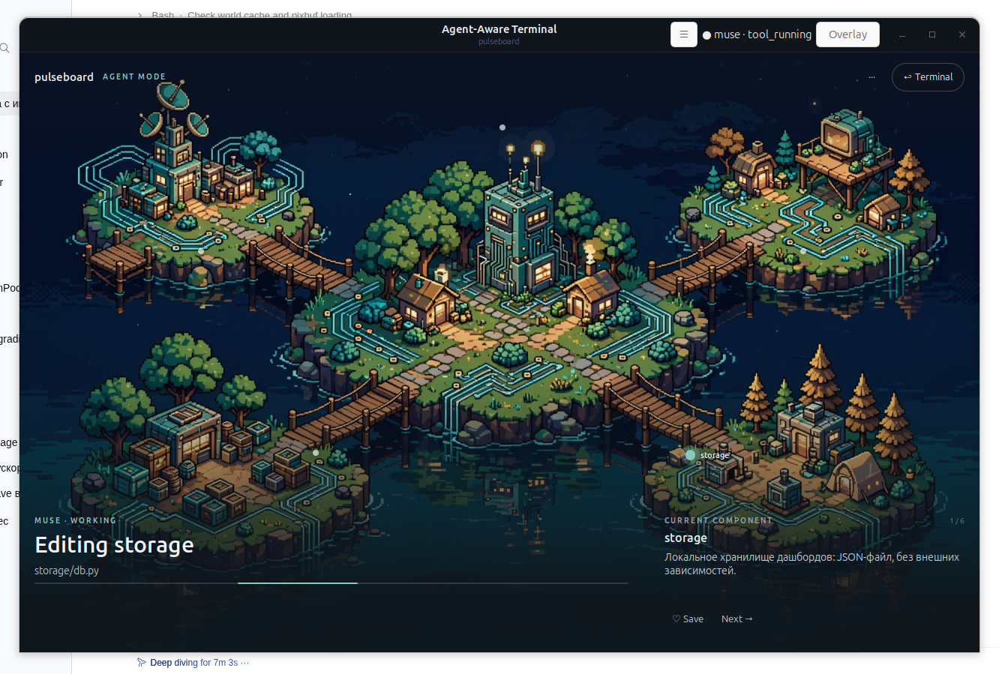
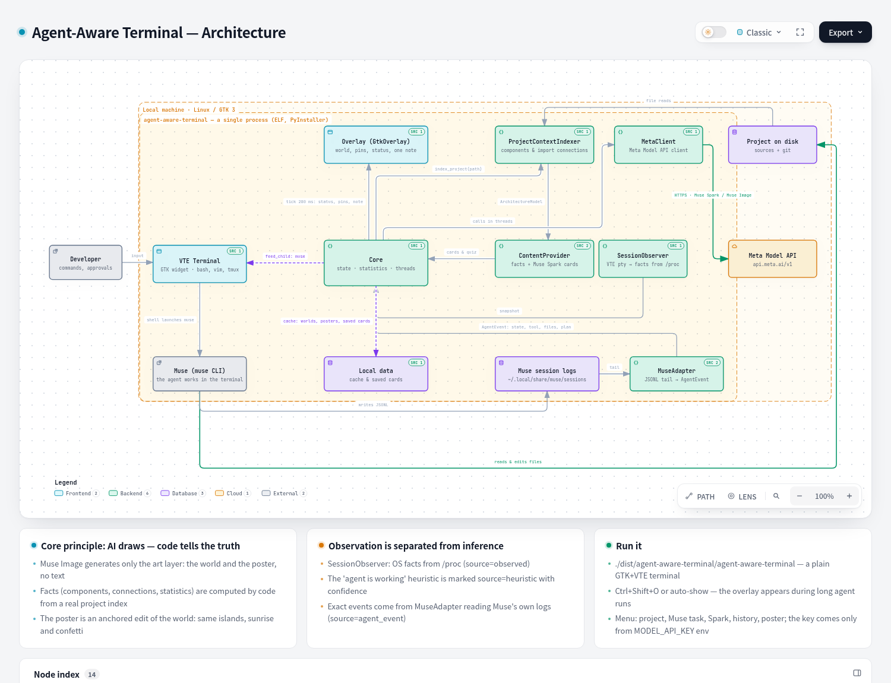

# Agent-Aware Terminal

**A terminal that understands an AI agent is working inside it — and turns
waiting into an interactive map of your project.**

Muse works → Muse Spark explains → Muse Image draws → you stay in context.



An implementation of phases 1–4 of the
[spec v0.2](../meta_hack/agent_aware_terminal_tz_v0_2.md) as one working
vertical slice, not four separate prototypes.

---

## Quick start

This is a **regular terminal application**: GTK 3 + VTE, no web pages, no
WebKit, no local servers. Run the binary:

```bash
export MODEL_API_KEY="LLM|..."   # Meta Model API key (dev.meta.ai)
./dist/agent-aware-terminal/agent-aware-terminal
```

A window opens that looks like an ordinary terminal: the shell is already
in the demo project, with only a thin header bar holding the agent
indicator and the Overlay button (`Ctrl+Shift+O`). From sources it is the
same: `./run.sh`. Rebuild the binary with `./build-binary.sh`; install a
launcher icon with `desktop/install-desktop.sh`. The demo project and app
data live in `~/.local/share/agent-aware-terminal/`.


Without a key the app still works: terminal, observation, the architecture
model and deterministic cards are available; only image generation and
Muse Spark explanations are not. The key is read **only** from the
environment variable and is never stored anywhere.

Requirements: Linux with GTK 3 + VTE (Ubuntu: `gir1.2-vte-2.91`),
Python 3.11+ when running from sources, and `muse` (Muse) installed
for the live scenario.

## The 90-second demo

1. Launch the binary — you are in a plain terminal inside the Pulseboard
   project (`api / core / storage / ui / tests`).
2. Menu ☰ → **"Run Muse with a task"** — a real Muse starts in
   this same terminal.
3. After a few seconds (the threshold is configurable) the overlay opens
   by itself on top of the terminal: a pixel-art project world by
   Muse Image, the active component lit by a pin, and one human sentence
   at the bottom saying what the agent is doing.
4. One contextual note at a time: Save / Next, plus a Muse Spark quiz
   (menu ☰ → "Enrich · Muse Spark").
5. When the agent finishes, the note offers a **"Session poster"**:
   Muse Image redraws the same world at sunrise (anchored composition).

No Muse quota? Menu ☰ → **"Simulate events (dev)"**. History,
diagnostics and settings live in menu ☰ → "History & diagnostics" (a side
panel, not part of the main screen).


---

## Design v1.0 — minimal / focus mode

The overlay follows a minimal design brief: not a dashboard, but a calm
waiting screen in the spirit of "minimal UI / strong typography / pixel
world / calm motion":

- **No right-hand timeline column** — event history moved to a secondary
  side panel ("History & diagnostics"), together with diagnostics and
  settings.
- **One contextual insight instead of a card row** (PROJECT INSIGHT /
  CURRENT COMPONENT / QUICK QUESTION) with Save and Next actions.
  Priority: current component → quiz → overview → other explanations;
  clicking a component on the scene changes the context.
- **Quiet pins instead of component plates.** Only the active component
  gets a label and a soft glow; everything else stays a small dot.
- Agent status is a human phrase, not a log: `Editing storage`,
  `Running tests`, `Thinking…`, "The agent needs you", "Done" — plus a
  thin progress line derived from plan steps (no invented percentages).
- Tokens: Inter, background `#10151B`, a single accent `#8CC8BE`; the
  world is muted (saturation .8, vignette, bottom gradient); attention
  and error states use semantic colors.

States: [idle](docs/assets/state-idle.png) ·
[working](docs/assets/state-working.png) ·
[thinking](docs/assets/state-thinking.png) ·
[needs attention](docs/assets/state-attention.png).
For reproducible screenshots there is a dev env var
`AAT_MOCKSTATE=idle|working|thinking|attention|completed` — it substitutes
only the display, not the data.

Known UI limitations: pins are placed on an ellipse and are not bound to
specific buildings in freshly generated art (binding to image regions is
the next art-direction step); the app is dark by design, a system light
theme is not applied yet; panel history is not filtered; the distribution
is ~550 MB (PyInstaller bundles all GTK typelibs — shrinkable by excluding
unused ones).

## How the spec phases map to code

| Spec phase | What is implemented | Where |
|---|---|---|
| **1. Terminal + overlay** | A real **VTE** terminal widget (the same as in GNOME Terminal): bash/vim/tmux/htop work as usual. The overlay is native GTK widgets over the terminal (`GtkOverlay`), `Ctrl+Shift+O`, auto-show during long agent runs | [native_terminal.py](desktop/native_terminal.py) |
| **2. Session awareness** | `SessionObserver`: foreground process, cmdline, cwd from `/proc`, process tree, agent-CLI detection, command lifecycle. Observations are separated from inferences (source + confidence) | [session_observer.py](backend/app/session_observer.py) |
| **3. Agent integration** | `MuseAdapter` for Muse: tails its replayable session JSONL log → normalized events of the spec §6.2 contract (`starting/planning/tool_running/awaiting_user/completed/failed`), plan from `write_todos`, files from tool calls, approval waits, subagent counter. Overlay auto-show with an anti-flicker threshold | [muse_adapter.py](backend/app/muse_adapter.py) |
| **4. Project awareness** | `ProjectContextIndexer`: git root, tree, README, manifests, components and import-derived connections (Python/JS), file→component mapping. Cards: deterministic facts + Muse Spark enrichment (explanations, quiz), card saving. The spec's graphical primitives (`ComponentNode`, `Connection`, `AgentMarker`, `ActivityAnimation`, `InfoCard`, `ProgressElement`) map to pins, the status line and the insight note | [project_indexer.py](backend/app/project_indexer.py), [content.py](backend/app/content.py) |

### Stack decision

Spec §3.1's candidate #1 was chosen: **GTK 3 + VTE** (no Flutter in this
environment). The first iteration went through a web UI and a WebKit
wrapper; on the requirement "no web pages" the web stack was removed from
the repository entirely. Now: the terminal host is `Vte.Terminal`, the
overlay is `GtkOverlay` with native widgets (`GtkImage` for the Muse Image
world, `GtkFixed` for component pins, `GtkLabel`/`GtkProgressBar` for
status), and all phase 2–4 logic is the same Python backend modules,
called in-process. There is no HTTP, WebSocket, or browser at runtime.

## Hybrid infographics: AI draws, code tells the truth

Muse Image is a reasoning model: it plans layout, keeps a series coherent
through anchored composition, and an image costs $0.01. But exact text and
numbers in generation are non-deterministic, so a generated "architecture
diagram" would be a fake. Our split is strict:

- **Generative layer** (Muse Image): the project world background, the
  session poster. Prompts forbid text; generation is async (~15 s) and
  cached.
- **Factual layer** (code): nodes, connections, labels, statistics,
  cards. Drawn natively on top of the image from the real
  `ArchitectureModel`.

The poster is made via `/v1/images/edits` with the world as a reference —
so the islands on the poster are the same as on the map, only at sunrise
with confetti.


## Architecture



An explorable version with source links lives in the repository root:
`.archify/architecture-agent-aware-terminal-20261031-1240/agent-aware-terminal.html`.

```text
┌───────────────── agent-aware-terminal (single process) ─────────────┐
│ GTK window: HeaderBar · Vte.Terminal ⇄ shell / muse                 │
│ GtkOverlay: Muse Image world · component pins · status · one note   │
│ Side panel: history · diagnostics · settings                        │
├─────────────────────────────────────────────────────────────────────┤
│ Core (in-process): MuseAdapter (tails muse logs) · SessionObserver  │
│ (/proc) · ProjectContextIndexer · cards · MetaClient                │
│ Meta Model API: Muse Spark (text) · Muse Image (worlds & posters)   │
└─────────────────────────────────────────────────────────────────────┘
```

## Tests

```bash
.venv/bin/python -m unittest discover -s backend/tests -v
```

9 tests: the indexer (components/connections/file→component), Muse event
normalization (tool calls, plan, approval), replay of a real Muse session
from this machine, and card determinism.

## Known limitations and next steps

- `muse exec` without a sandbox on this machine: Bubblewrap needs user
  namespaces, and headless approval waits for external confirmation — so
  the demo menu entry uses `muse exec --yolo` **only** on the trusted
  demo repository. For your own projects, run interactive `muse` in the
  terminal: the overlay will show `awaiting_user`, and you approve in the
  agent's TUI.
- One adapter so far (Muse). `AgentAdapter`s for Codex / Claude Code are
  next in line; the event contract is already shared.
- Indexer: connections only from Python/JS imports, no monorepo package
  graph, no incremental file-watch updates yet.
- Next per the spec: research on the auto-show threshold and
  return-to-task metrics (spec §10).

## API key safety

The Meta API key is passed only via the `MODEL_API_KEY` environment
variable of the app process. The key is not in the repository, logs, or
code; any test key used during development must be revoked at dev.meta.ai
afterwards.
