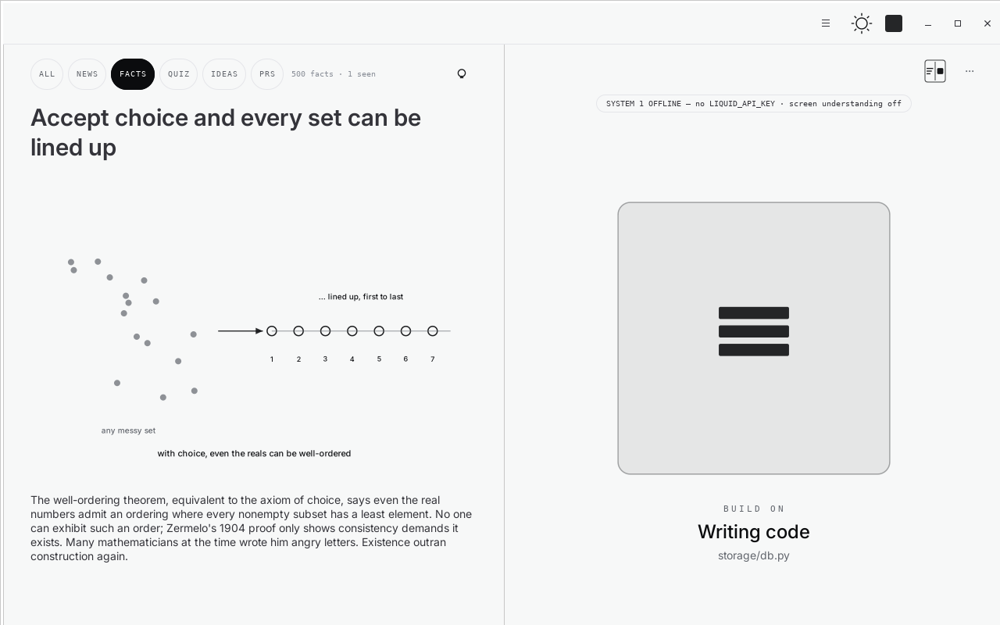

# Fancy Terminal — application guide

The application is named Agent-Aware Terminal in source paths, configuration,
and the binary. For the product overview and video, see the
[repository README](../README.md).



*Built application, content-tour mode, simulated working indicator.*

## Install and run

Linux with GTK 3 + VTE is required. On Ubuntu / Debian:

```bash
sudo apt install git python3-gi python3-gi-cairo python3-requests \
    gir1.2-gtk-3.0 gir1.2-vte-2.91
git clone --recurse-submodules https://github.com/FastAnt/meta_hack.git
cd meta_hack/agent-aware-terminal
./run.sh --project ~/dev/my-project
```

`./run.sh` chooses a Python interpreter that can import PyGObject, preferring
`.venv/bin/python`, then `/usr/bin/python3`. Python 3.11+ is required. If the
catalogue is missing, run `git submodule update --init --recursive` at the repo root.

Without `--project`, the app opens its bundled demo project. You can also `cd`
inside the terminal; the content pool follows the observed project directory.
Project cards live in `<project>/.aat/content/`.

Build and run the packaged application:

```bash
./build-binary.sh
./dist/agent-aware-terminal/agent-aware-terminal --project ~/dev/my-project
```

The build creates `.venv-build/`, bundles Python dependencies, and copies the
external content catalogue and researcher instructions beside the binary.
A compatible Linux desktop and GTK/VTE libraries are still required.
`desktop/install-desktop.sh` installs a desktop launcher.

## Credentials and providers

The app works without model credentials: the terminal, catalogue, fallback
observation, and measured file changes remain available. Model perception and
DONE/SAFE judgments require a Liquid key.

Create a local `keys.sh` in this directory if needed:

```bash
export MODEL_API_KEY="YOUR_META_API_KEY"
export SYSTEM_1_MODEL_API_KEY="YOUR_LIQUID_API_KEY"
```

`LIQUID_API_KEY` is also accepted. `keys.sh` is git-ignored and must never be
committed. Restrict access with `chmod 600 keys.sh`. The loader searches
`$AAT_KEYS_FILE`, the working directory, the app's parent directories, its data
directory, then `~/.config/agent-aware-terminal/keys.sh`. Existing environment
variables take precedence.

The content researcher is a separate agent. Settings supports Muse (default),
Codex, Kilo, a custom command, or an OpenAI-compatible model endpoint. Install
and authenticate your chosen CLI separately; the Meta API key alone does not
install a creator. Relevant environment settings include:

| Variable | Purpose |
| --- | --- |
| `AAT_CREATOR_PROVIDER` | `muse`, `codex`, `kilo`, `custom`, or `llm` |
| `AAT_CREATOR_MODEL` | Model override for CLI providers |
| `AAT_CREATOR_CMD` | Custom creator command |
| `AAT_CREATOR_LLM_BASE_URL` | Base URL for the built-in model harness |
| `AAT_CREATOR_LLM_API_KEY` | Credential for that endpoint |
| `AAT_CREATOR_LLM_MODEL` | Model for that endpoint |
| `AAT_CREATOR=off` | Disable creator launches |

The Muse creator uses `muse exec --yolo`. Its mission restricts writes to `.aat/`,
but that is not an OS-enforced sandbox. The built-in LLM harness checks its file
write destinations; Python content packs and validators still execute code.
Only load trusted content and review generated output.

For live PR cards, install the GitHub CLI and authenticate with `gh auth login`.
The current project must have a GitHub remote. Missing prerequisites or an empty
PR pool produce an explanatory empty state.

## Everyday workflow

Start your coding agent inside the terminal. While it works, a small hint offers
surf mode for four seconds without taking keyboard focus. The feed opens only
when you choose it. Finished-turn results may open the visualization if enabled
in Settings.

| Control | Action |
| --- | --- |
| `Alt+I` | Toggle surf mode |
| `Esc` | Close the current layer / return to the terminal |
| Agent square | Return to the terminal from the feed |
| View button | Cycle terminal + visualization, feed + visualization, terminal + feed |
| Theme button | Cycle Auto, Light, Dark |
| `Ctrl+Shift+O` | Toggle the visualization |
| `↑` / `↓` | Previous / next card while the terminal is hidden |
| Wheel / swipe | Browse cards; scroll long cards before paging |
| `Shift+Enter` / `Alt+Enter` | Send a newline using kitty CSI-u to compatible agent TUIs |
| `Ctrl+Shift+C` / `Ctrl+Shift+V` | Copy / paste |

Filter chips select **All / News / Facts / Quiz / Ideas / PRs**. Reactions inform
future ranking; the deck cycles when its current pool is exhausted. Settings →
Watched content resets viewing history while keeping reactions.

The bulb cycles **off → create one → create continuously**. Continuous creation
pauses once the selected category has ten unread cards. Empty content categories
can also trigger the researcher. Requests and lifecycle records live under
`<project>/.aat/research/`.

## How observation works

With a Liquid key, the default `AAT_PERCEPTION=system1` path interprets terminal
screenshots, screen text, and measured dynamics. A state machine smooths those
judgments into working, waiting, and finished states. The Muse log adapter does
not run in this mode.

Without a key, or with `AAT_PERCEPTION=legacy`, observation uses process trees,
commands, screen changes, and Muse logs where available. Agent support depends
on process detection and the evidence exposed by each CLI.

At the end of an observed turn:

- **FILES** comes from a baseline snapshot and filesystem diff.
- **DONE** and **SAFE** are model judgments on a 0–4 scale with confidence.
- Replayed session history must not create a live completion or new scores.

The activity indicator includes distinct modes for thinking, search, editing,
builds, tests, approvals, questions, completion, and failure. It is an estimate
of activity, not a guarantee that a task succeeded.

## Content and model roles

The content engine loads external Python packs and JSON cards. Project content
gets priority; a local vector index retrieves candidates, and System-1 picks
among them when available. Retrieval ranking is the fallback. Likes, dislikes,
and viewing history affect later choices.

Meta models support content creation through the researcher. Meta Image project
worlds and session posters remain experimental backend paths; they are not shown
in the current interface. See the [researcher guide](content-researcher/README.md)
and [architecture](../ARCHITECTURE.md) for details.

## Data and diagnostics

Default app data: `~/.local/share/agent-aware-terminal/`.

- `decisions.log`: state, perception, content, and scoring decisions.
- `ui_prefs.json`: theme, view, and content-filter preferences.
- `content_state.json`: catalogue viewing progress.
- `content_index.db`: vectors, reactions, and serve history.
- `<project>/.aat/`: project content and researcher records.

`AAT_DATA_DIR` overrides the app data location. Test instances must use a unique
`AAT_APP_ID=dev.meta.aat.<name>` and their own data directory. Close only the
instance you launched; do not kill other terminal instances or change system
keyboard/IBus settings.

## Development and checks

```bash
/usr/bin/python3 -m venv --system-site-packages .venv
.venv/bin/pip install requests pycairo
.venv/bin/python -m unittest discover -s backend/tests
python3 tools/simulate.py sims/demo_run.jsonl
python3 tools/test_game.py <pack-or-directory>
```

Run unit tests without production API credentials: legacy scenarios assume an
unconfigured model client. Use a separate `AAT_DATA_DIR` for test output.

For a manual content preview from the built binary:

```bash
AAT_APP_ID=dev.meta.aat.preview AAT_DATA_DIR=/tmp/aat-preview \
AAT_CREATOR=off AAT_TOUR=manual AAT_TOUR_TYPE=fact \
./dist/agent-aware-terminal/agent-aware-terminal
```

`AAT_THEME=light|dark` selects a preview theme. `AAT_MOCKSTATE=working` and other
mock states substitute the displayed activity for visual checks. Such screenshots
must be labelled as previews, not evidence of live agent execution. Inspect the
instance's `decisions.log` alongside the UI when validating behavior.
