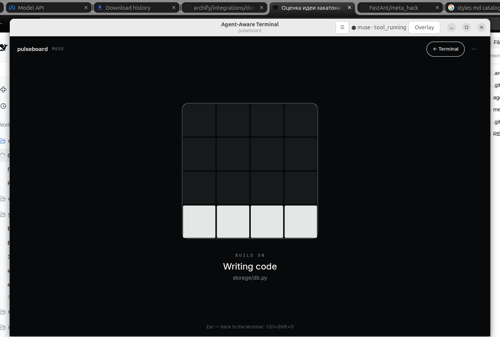
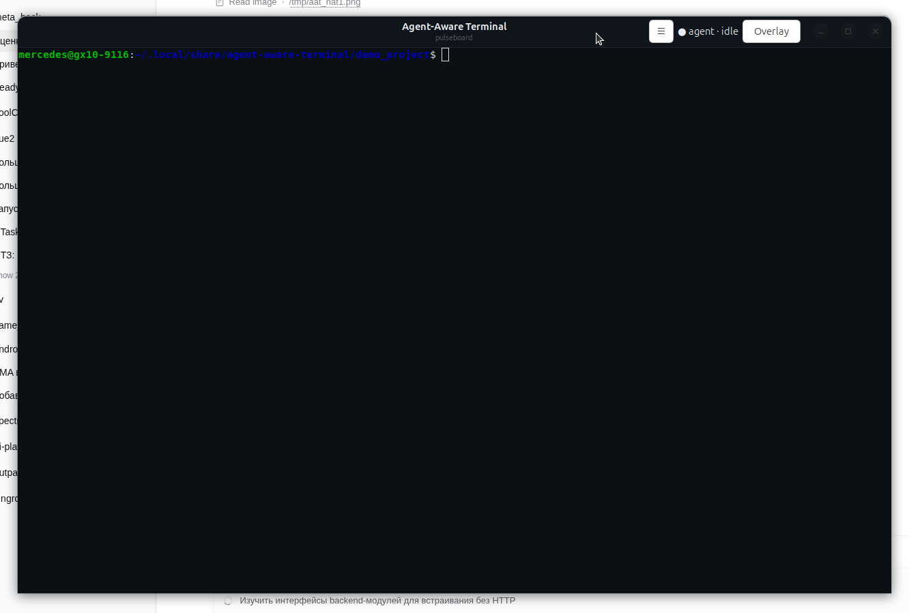

# Agent-Aware Terminal

**A terminal that understands an AI agent is working inside it — and turns
waiting into an interactive map of your project.**

Muse works → Muse Spark explains → Muse Image draws → you stay in context.



An implementation of phases 1–4 of the
[spec v0.2](../meta_hack/agent_aware_terminal_tz_v0_2.md) as one working
vertical slice, not four separate prototypes.

---

## Quick start

This is a **regular terminal application**: GTK 3 + VTE, no web pages, no
WebKit, no local servers. Run the binary:

```bash
export MODEL_API_KEY="LLM|..."   # Meta Model API key (dev.meta.ai)
./dist/agent-aware-terminal/agent-aware-terminal
```

Or put the keys in a `keys.sh` file — the app loads it automatically at
startup (real environment variables win). It searches `$AAT_KEYS_FILE`,
`./keys.sh`, `keys.sh` next to the app (repo root / binary folder), then
`~/.config/agent-aware-terminal/keys.sh`:

```bash
export MODEL_API_KEY="LLM|..."
export SYSTEM_1_MODEL_API_KEY="liquid_..."   # Liquid AI, for the gate
```

`keys.sh` is git-ignored and must never be committed.

A window opens that looks like an ordinary terminal: the shell is already
in the demo project, with only a thin header bar holding the agent
indicator and the Overlay button (`Ctrl+Shift+O`). From sources it is the
same: `./run.sh`. Rebuild the binary with `./build-binary.sh`; install a
launcher icon with `desktop/install-desktop.sh`. The demo project and app
data live in `~/.local/share/agent-aware-terminal/`.



Without a key the app still works: terminal, observation, the architecture
model and deterministic cards are available; only image generation and
Muse Spark explanations are not. The key is read **only** from the
environment variable and is never stored anywhere.

Requirements: Linux with GTK 3 + VTE (Ubuntu: `gir1.2-vte-2.91`),
Python 3.11+ when running from sources, and `muse` (Muse) installed
for the live scenario.

## The 90-second demo

1. Launch the binary — you are in a plain terminal inside the Pulseboard
   project (`api / core / storage / ui / tests`).
2. Menu ☰ → **"Run Muse with a task"** — a real Muse starts in
   this same terminal.
3. After a few seconds (the threshold is configurable) the overlay opens
   by itself on top of the terminal: a single animated square in the
   middle of the screen shows what the agent is doing (see the modes
   below), with one human sentence underneath.
4. If the agent needs you, the square shuffles — **click it and you are
   back in the terminal** to answer.
5. When the agent finishes, the square settles back to a calm blink.

No Muse quota? Menu ☰ → **"Simulate events (dev)"**. History,
diagnostics and settings live in menu ☰ → "History & diagnostics" (a side
panel, not part of the main screen).

---

## Design v2 — the agent square

The overlay is deliberately almost empty. It follows the system theme
(dark or light), uses a grotesk typeface (Inter, bundled with the app),
hairline borders and pill buttons — no generated imagery, no dashboard.

In the center sits **one square, ~30% of the window**, whose animation is
the whole status display (in the spirit of FUI field-guide glyphs):

| Mode | Animation | Meaning |
|---|---|---|
| `BLINKY` | a calm blinking square | idle, done, or no agent connected |
| `GLITCH` | the square slices and jitters | searching the local system (files, code) |
| `TRAIL` | the square moves, leaving a trail | searching the web |
| `SHUFFLE` | four tiles keep swapping | the agent needs you — click the square to return to the terminal |
| `COLOR FLASH` | the square slowly flashes color | thinking / planning |
| `BUILD ON` | a 4×4 grid fills bottom-up | writing code or files, running builds/tests |

Under the square: the mode name (mono, letterspaced), one human phrase
("Writing code") and the current activity in one line. Nothing else. The
mode is derived from the normalized agent event: `awaiting_user` →
SHUFFLE, `planning` → COLOR FLASH, search/read tools → GLITCH, web tools
→ TRAIL, edit/bash tools → BUILD ON, everything else → BLINKY.

## When does the overlay open? A System-1 gate

The overlay never opens just because time passed (an earlier build
re-opened it every 280 ms after a manual close — that bug is fixed: a
manual close is respected for the rest of the task, and clicking the
square always returns to the terminal).

Instead, a fast decision model decides. Once the user has given the agent
a task and the agent has taken a couple of steps, the app asks
**Liquid AI's d1.1 decision model** (`POST
https://api.liquid.ai/decisions/v1/systemone`, a `noul` question —
probability, zero generated tokens): *"Will the agent keep working
autonomously for more than ~20 seconds?"* Only a "long" answer opens the
overlay — once per task. A "short" answer is re-checked every 25 s (max
4 times) as the work grows. Key: `LIQUID_API_KEY` (or
`SYSTEM_1_MODEL_API_KEY`, e.g. from `keys.sh`); without one, a documented heuristic decides
(plan ≥ 3 items, ≥ 4 steps, or ≥ 25 s elapsed) and the source is shown in
Diagnostics.

## After the run: three result squares

When the agent finishes, the overlay shows what it did — three small
squares under the main one:

1. **FILES · n** — a grid with exactly one cell per modified file, from
   the real `git diff --numstat` (untracked files count as added):
   green where lines were mostly added, red where mostly removed.
2. **DONE · x/4** — a fill square: how completely the task was done.
   d1.1 scores the task + plan + final report + diff against a 5-level
   rubric; the square fills to `score/4` and the caption shows the level
   and the model confidence.
3. **SAFE · x/4** — the same, for how safe the changes are for the
   project and the system (deletions, scope, irreversibility, secrets,
   verification), 5 levels from "dangerous" to "very safe".

Without a Liquid key both scores fall back to transparent heuristics
(plan completion ratio; deletion ratio and file count), labelled as such
in Diagnostics.

Palettes are Linear-style token stacks (dark: `#08090a` canvas, `#f7f8f8`
text, 1px `#23252a` borders; light: the same roles inverted). The theme is
read from GTK settings at startup (`AAT_THEME=dark|light` overrides, for
screenshots). Richer visualization — architecture, plans, generated
worlds — returns in the next design iteration, once we agree how to show
more data; the Muse Image / Spark pipelines remain in `Core` meanwhile.

States: [idle](docs/assets/state-idle.png) ·
[working / BUILD ON](docs/assets/state-working.png) ·
[thinking / COLOR FLASH](docs/assets/state-thinking.png) ·
[needs attention / SHUFFLE](docs/assets/state-attention.png) ·
[GLITCH](docs/assets/mode-glitch.png) · [TRAIL](docs/assets/mode-trail.png) ·
[dark theme](docs/assets/state-dark-working.png).
For reproducible screenshots there is a dev env var
`AAT_MOCKSTATE=idle|working|thinking|attention|completed|glitch|trail` —
it substitutes only the display, not the data.

Known limitations: theme is chosen at startup (no live system-theme
switching yet); on the `TRAIL`/`GLITCH` distinction the app relies on
tool names, so an agent that hides its tools degrades to BUILD ON.

## How the spec phases map to code

| Spec phase | What is implemented | Where |
|---|---|---|
| **1. Terminal + overlay** | A real **VTE** terminal widget (the same as in GNOME Terminal): bash/vim/tmux/htop work as usual. The overlay is native GTK widgets over the terminal (`GtkOverlay`): a system-theme surface with one animated agent square, `Ctrl+Shift+O`, auto-show during long agent runs | [native_terminal.py](desktop/native_terminal.py) |
| **2. Session awareness** | `SessionObserver`: foreground process, cmdline, cwd from `/proc`, process tree, agent-CLI detection, command lifecycle. Observations are separated from inferences (source + confidence) | [session_observer.py](backend/app/session_observer.py) |
| **3. Agent integration** | `MuseAdapter` for Muse: tails its replayable session JSONL log → normalized events of the spec §6.2 contract (`starting/planning/tool_running/awaiting_user/completed/failed`), plan from `write_todos`, files from tool calls, approval waits, subagent counter. Overlay auto-show with an anti-flicker threshold | [muse_adapter.py](backend/app/muse_adapter.py) |
| **4. Project awareness** | `ProjectContextIndexer`: git root, tree, README, manifests, components and import-derived connections (Python/JS), file→component mapping. Cards: deterministic facts + Muse Spark enrichment (explanations, quiz), card saving. The spec's graphical primitives (`ComponentNode`, `Connection`, `AgentMarker`, `ActivityAnimation`, `InfoCard`, `ProgressElement`) map to pins, the status line and the insight note | [project_indexer.py](backend/app/project_indexer.py), [content.py](backend/app/content.py) |

### Stack decision

Spec §3.1's candidate #1 was chosen: **GTK 3 + VTE** (no Flutter in this
environment). The first iteration went through a web UI and a WebKit
wrapper; on the requirement "no web pages" the web stack was removed from
the repository entirely. Now: the terminal host is `Vte.Terminal`, the
overlay is `GtkOverlay` with native widgets (`GtkImage` for the Muse Image
world, `GtkFixed` for component pins, `GtkLabel`/`GtkProgressBar` for
status), and all phase 2–4 logic is the same Python backend modules,
called in-process. There is no HTTP, WebSocket, or browser at runtime.

## Hybrid infographics: AI draws, code tells the truth

Muse Image is a reasoning model: it plans layout, keeps a series coherent
through anchored composition, and an image costs $0.01. But exact text and
numbers in generation are non-deterministic, so a generated "architecture
diagram" would be a fake. Our split is strict:

- **Generative layer** (Muse Image): the project world background, the
  session poster. Prompts forbid text; generation is async (~15 s) and
  cached.
- **Factual layer** (code): nodes, connections, labels, statistics,
  cards. Drawn natively on top of the image from the real
  `ArchitectureModel`.

The poster is made via `/v1/images/edits` with the world as a reference —
so the islands on the poster are the same as on the map, only at sunrise
with confetti.

> Status: worlds and posters are currently **not displayed** — the
> overlay was reduced to the minimal agent square (Design v2 above) and
> the data visualization will be redesigned next. The generation code
> (`Core.world_async`, `Core.poster_async`) remains in place.


## Architecture


An explorable version with source links lives in the repository root:
`.archify/architecture-agent-aware-terminal-20261031-1240/agent-aware-terminal.html`.

```text
┌───────────────── agent-aware-terminal (single process) ─────────────┐
│ GTK window: HeaderBar · Vte.Terminal ⇄ shell / muse                 │
│ GtkOverlay: Muse Image world · component pins · status · one note   │
│ Side panel: history · diagnostics · settings                        │
├─────────────────────────────────────────────────────────────────────┤
│ Core (in-process): MuseAdapter (tails muse logs) · SessionObserver  │
│ (/proc) · ProjectContextIndexer · cards · MetaClient                │
│ Meta Model API: Muse Spark (text) · Muse Image (worlds & posters)   │
└─────────────────────────────────────────────────────────────────────┘
```

## Tests

```bash
.venv/bin/python -m unittest discover -s backend/tests -v
```

9 tests: the indexer (components/connections/file→component), Muse event
normalization (tool calls, plan, approval), replay of a real Muse session
from this machine, and card determinism.

## Known limitations and next steps

- `muse exec` without a sandbox on this machine: Bubblewrap needs user
  namespaces, and headless approval waits for external confirmation — so
  the demo menu entry uses `muse exec --yolo` **only** on the trusted
  demo repository. For your own projects, run interactive `muse` in the
  terminal: the overlay will show `awaiting_user`, and you approve in the
  agent's TUI.
- One adapter so far (Muse). `AgentAdapter`s for Codex / Claude Code are
  next in line; the event contract is already shared.
- Indexer: connections only from Python/JS imports, no monorepo package
  graph, no incremental file-watch updates yet.
- Next per the spec: research on the auto-show threshold and
  return-to-task metrics (spec §10).

## API key safety

The Meta API key is passed only via the `MODEL_API_KEY` environment
variable of the app process. The key is not in the repository, logs, or
code; any test key used during development must be revoked at dev.meta.ai
afterwards.
